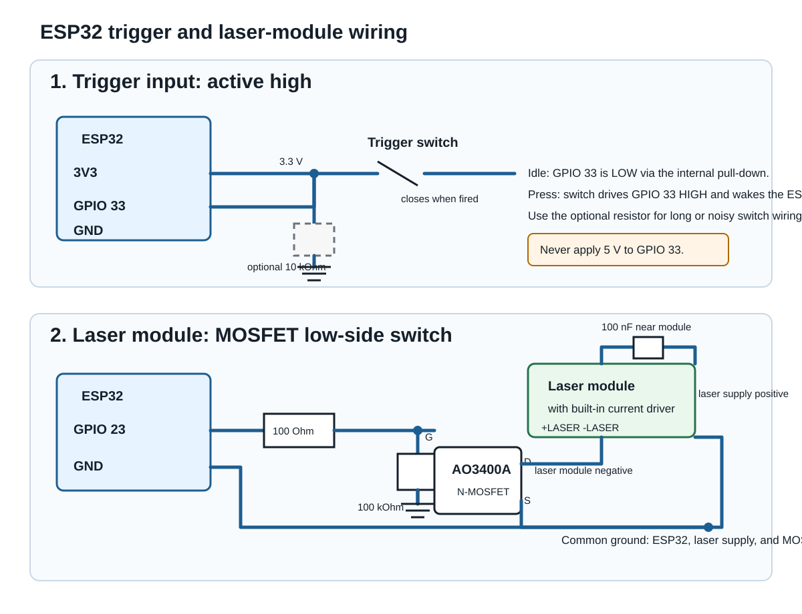

# ESP32 BLE protocol v1

The ESP32 is a BLE peripheral named `Gunslinger-ESP32`. Linux uses BlueZ and
Python Bleak as the central. One gun is supported in this prototype.

* Service UUID: `02f8b7a0-14b9-4e9e-9f6c-7d6054301000`
* Notify characteristic: `02f8b7a0-14b9-4e9e-9f6c-7d6054301001`

| Offset | Bytes | Meaning |
| --- | --- | --- |
| 0 | 1 | Version: `1` |
| 1 | 1 | Event: `1` = trigger |
| 2 | 4 | Unsigned shot sequence, little-endian |

Example: `01 01 2a 00 00 00` is shot 42. Increment once per physical press.
Turn the laser on **before** the notification; the firmware example holds it on
for 300 ms. Debounce the trigger. Reload logic stays in the pistol: Lightgun
mode has infinite ammunition. Duplicate sequences are ignored per connection;
reconnecting allows the ESP32's counter to restart.

## Power saving and trigger wiring

The example firmware enters ESP32 deep sleep after ten minutes without a fired
shot. It changes the trigger input from GPIO 18 to **GPIO 33**, because GPIO 33
is RTC-capable and can wake the original ESP32 from deep sleep. Wire the trigger
between GPIO 33 and 3.3 V; the firmware enables its pull-down. GPIO 18 cannot
be used for deep-sleep wake, so move an existing trigger wire before flashing
this version.

A press pulls GPIO 33 high and wakes the ESP32. The firmware resumes BLE
advertising, waits for the bridge to reconnect, then emits that waking shot once
and turns on the laser. The waking shot can therefore be delayed by BLE
reconnection. It only enters deep sleep when the trigger has returned low, so a
held trigger cannot cause an immediate wake loop. No desktop Bluetooth pairing
is needed.

### Trigger wiring

Use the ESP32's 3.3 V rail, not 5 V, for the trigger input. The firmware enables
GPIO 33's internal RTC pull-down, so a short switch connection does not need an
external resistor. The switch closes only when the trigger is pulled.



Do not connect GPIO 33 to a 5 V trigger circuit: ESP32 GPIOs are 3.3 V-only.
Use the optional external 10 kOhm pull-down when the trigger wiring is long,
runs alongside the laser supply, or is electrically noisy. It gives a stronger,
more predictable idle level than the ESP32's internal pull-down. The firmware
already debounces the switch; no capacitor is required.

### Laser power switching

Do not power a bare laser diode directly from GPIO 23. A correctly calculated
series resistor and transistor can operate a known, low-power laser diode, but
it is less tolerant of supply, temperature and part variation than it is for a
normal indicator LED. Laser diodes have a sharp threshold and a strong
temperature dependence: a small current increase can create a large optical
power increase, while excessive current can cause permanent damage. A guessed
resistor is therefore unsafe. Use a laser **module with an integrated driver**
that is rated for the supply voltage and output power, or use a separate
constant-current laser-diode driver designed for the specific bare diode.

For a 3.3 V or 5 V laser module drawing up to 100 mA, use an AO3400A (or another
logic-level N-channel MOSFET specified with an `Rds(on)` value at `Vgs = 2.5 V`
or lower) as a low-side switch:

The 100 Ohm gate resistor limits switching transients, and the 100 kOhm
gate-to-ground resistor keeps the laser off while the ESP32 is booting or in
deep sleep. The laser-module supply ground and ESP32 ground must be common.
Place the 100 nF capacitor physically close to the module; add a 47 uF or
larger capacitor across the module supply if its wiring is long or the module
manufacturer recommends it. Select the supply voltage from the module's label
or datasheet—do not assume that every module accepts 5 V.

The camera captures continuously. On a trigger the detector examines buffered
frames from 80 ms before receipt through 250 ms after, with a background from
at least 200 ms before receipt. It requires two consecutive nearby detections
and uses the earlier position to reduce aim drift. Acquisition timestamps are
software receipt timestamps, not exact sensor exposure timestamps.

Calibration stores camera coordinates normalized to `[0,1]`, in projector
TL/TR/BR/BL order. OpenCV's homography maps these to normalized game coordinates.
No calibration, no detected laser or a point outside the projector means a miss.
Thresholds and timing require validation with the actual projector/camera/gun.

## Local endpoints

All endpoints bind only to `127.0.0.1`. No internet is used during gameplay.

* UDP 4242: bridge -> Godot shot/status JSON.
* UDP 4243: simulated trigger commands, accepted only by the mock camera.
* HTTP 4244: `GET /frame.jpg`, `GET /status`, `GET /calibration`, `POST /calibration`.

```json
{"type":"shot","id":"session:42:1","found":true,"x":0.45,"y":0.62,"fired_at":1791759600.0,"latency_ms":67}
```

Misses have `found:false` and a reason. One event per trigger. Godot ignores
duplicates and expired events. Local UDP is a prototype transport without ACKs.
Calibration POST: `{"corners":[[0,0],[1,0],[1,1],[0,1]]}`.

Arduino example: `firmware/esp32_gunslinger/esp32_gunslinger.ino`. Adapt pins to
your existing button/laser-driver circuit and compile with the ESP32 Arduino
board support package. No firmware compilation or hardware BLE test has been
performed without the board/toolchain.
